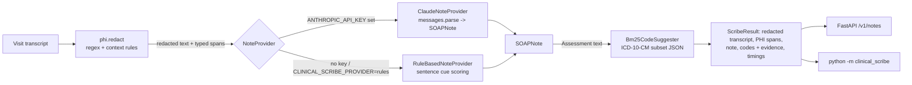

# clinical-scribe

> **Research prototype. NOT FOR CLINICAL USE.** Do not use it with real patient data or for
> clinical, coding or billing decisions. Every transcript in this repo is synthetic.

clinical-scribe turns a doctor–patient visit transcript into a draft SOAP note and suggests ICD-10-CM
codes for it. **PHI is removed before any model sees the text.** A deterministic de-identifier
(regex plus a few context rules) replaces the HIPAA Safe Harbor identifiers that show up in
conversation. The redacted transcript then goes to a note provider: either Claude with structured
outputs, or an offline rule-based classifier that sorts each sentence into Subjective / Objective /
Assessment / Plan. Finally a BM25 ranker matches the Assessment against a curated ICD-10-CM subset
and returns each candidate code with the terms that matched it. The technical interest is in
making each stage measurable on its own: the repo includes a gold-annotated synthetic set with a
dev/held-out split, plus an evaluation script that reports PHI recall/precision by type,
section-classification accuracy, ICD-10 top-k accuracy and latency.

## Features

- **PHI de-identification** (`clinical_scribe/phi.py`) covers names (titles, "patient <Name>",
  signatures, relatives, greetings, header lines, then propagation to every later mention), dates
  (year kept: `[DATE:2091]`), phone, fax, e-mail, SSN, MRN, account/member IDs, street addresses,
  ZIPs, URLs, IPs and ages over 89 (`[AGE:90+]`). Each span is returned with its type and its offsets
  in the original text.
- **SOAP note drafting** (`clinical_scribe/notes.py`) uses one `NoteProvider` interface with two
  implementations:
  - `ClaudeNoteProvider`: `client.messages.parse(..., output_format=SOAPNote)` on `claude-opus-5-5`
    with `effort: "medium"`, a refusal check, server-side fallback, and SDK errors mapped to one
    `NoteGenerationError`.
  - `RuleBasedNoteProvider`: offline and deterministic. It scores weighted lexical cues and uses
    the speaker's role. It also pulls out medications (name, dose, frequency) and the follow-up
    interval.
- **ICD-10-CM suggestions** (`clinical_scribe/coding.py`) use Okapi BM25 (unigrams plus bigrams,
  light stemming, negated clauses removed) over 118 codes in `clinical_scribe/data/icd10_subset.json`.
  Each code has a description and lay synonyms. Results are top-k codes with scores and the
  matched terms as evidence.
- **FastAPI service** offers `POST /v1/notes` and `GET /healthz`. The CLI is
  `python -m clinical_scribe note file.txt`.
- **Evaluation** (`eval/`) covers 28 synthetic annotated visits across 22 specialties and writes
  `eval/RESULTS.md`.

## Architecture



- **Redaction runs first and unconditionally.** `ScribePipeline` only ever passes `redact(text).text`
  to the provider, and a unit test checks this. Identifiers never reach the LLM, so no prompt
  instruction is needed to keep them private.
- **The de-identifier is rules-based on purpose.** It is deterministic, has no dependencies, is
  fast (under 1 ms per note), and you can audit why each span was redacted. The trade-off is lower
  recall on free-form names, and the held-out numbers below show it.
- **One provider interface, chosen by environment.** Claude is used when `ANTHROPIC_API_KEY` is
  set. Otherwise the rule-based provider runs, so tests, CI and the evaluation never touch the
  network.
- **Codes are suggestions with evidence, not decisions.** BM25 over description plus synonyms is
  easy to inspect: every suggestion lists the query terms that produced it. Binary term frequency
  stops one code from winning just because it has many synonyms.

## Quickstart

```bash
python -m venv .venv
source .venv/Scripts/activate        # Windows Git Bash; use .venv/bin/activate on Linux/macOS
pip install -e ".[dev]"

# CLI (offline)
python -m clinical_scribe note examples/visit.txt --offline

# API (offline provider forced; set ANTHROPIC_API_KEY instead to use Claude)
CLINICAL_SCRIBE_PROVIDER=rules uvicorn clinical_scribe.api:app --port 8765
```

Real CLI output for `examples/visit.txt` (a synthetic strep-throat visit):

```text
# SOAP note draft (provider: rules)
> Research prototype. NOT FOR CLINICAL USE. Output must be reviewed by a clinician.

## Subjective
- I've had a sore throat and fever for the past three days.
- It really hurts to swallow and I have no cough.
- My daughter [NAME] had strep throat last week.

## Objective
- Temperature is 101.3 degrees and heart rate is 96.
- On exam, the tonsils are swollen with white exudate and the neck nodes are tender.
- The rapid strep test came back positive.

## Assessment
- This is most likely strep throat.

## Plan
- I'll prescribe amoxicillin 500 mg twice a day for 10 days.
- Take ibuprofen 400 mg every 6 hours as needed for pain and fever.
- Please come back in one week if you are not feeling better.

## Medications
- amoxicillin (500 mg, twice a day)
- ibuprofen (400 mg, every 6 hours)

## Follow-up
Please come back in one week if you are not feeling better.

## Suggested ICD-10-CM codes (decision support only)
- J02.0 Streptococcal pharyngitis (score 13.518; matched: strep throat, throat, strep)
- J02.9 Acute pharyngitis, unspecified (score 4.015; matched: throat)

PHI redacted: DATE x1, MRN x1, NAME x5
Timings (ms): {'phi': 1.186, 'note': 0.634, 'coding': 0.193, 'total': 2.013}
```

API request against the running server, with an excerpt of the real response:

```bash
curl -s localhost:8765/healthz
# {"status":"ok","provider":"rules"}
python -c "import json;print(json.dumps({'transcript':open('examples/visit.txt').read()}))" > req.json
curl -s -X POST localhost:8765/v1/notes -H 'content-type: application/json' --data @req.json
```

```json
{
  "redacted_transcript": "Visit date: [DATE:2091]   Patient name: [NAME]   MRN: [MRN]\nDoctor: Good morning Mr. [NAME], I'm Dr. [NAME]. ...",
  "phi_spans": [{"type": "DATE", "start": 12, "end": 22, "text": "04/12/2091", "replacement": "[DATE:2091]"}, "... 7 spans"],
  "note": {"subjective": ["..."], "objective": ["..."], "assessment": ["This is most likely strep throat."], "plan": ["..."],
           "medications": [{"name": "amoxicillin", "dose": "500 mg", "frequency": "twice a day"}, "..."], "follow_up": "Please come back in one week if you are not feeling better."},
  "suggested_codes": [{"code": "J02.0", "description": "Streptococcal pharyngitis", "score": 13.518, "evidence": ["strep throat", "throat", "strep"]}, "..."],
  "provider": "rules",
  "timings_ms": {"phi": 1.564, "note": 0.611, "coding": 0.138, "total": 2.313},
  "disclaimer": "Research prototype. NOT FOR CLINICAL USE. Output must be reviewed by a clinician."
}
```

## Results

**These are offline baseline numbers.** They come from the rule-based provider and the BM25 coder.
No LLM was called, and I have not measured Claude's note quality.

- Command: `python -m eval.run --repeats 20` (the full report is in [`eval/RESULTS.md`](eval/RESULTS.md))
- Data: 28 **synthetic** transcripts in `eval/data/` (17 dev, 11 held-out test). They contain 360
  gold-labelled sentences and 133 gold PHI spans.
- Machine: 12th Gen Intel Core i7-12700, Windows 11, Python 3.13.12
- Date measured: 2026-11-06

| Metric | dev (17) | held-out test (11) | all (28) |
|---|---|---|---|
| PHI recall, type-matched (micro) | 0.99 (82/83) | 0.80 (40/50) | 0.92 (122/133) |
| PHI recall, any type redacted | 0.99 (82/83) | 0.80 (40/50) | 0.92 (122/133) |
| PHI precision (micro) | 1.00 (82/82) | 1.00 (40/40) | 1.00 (122/122) |
| Sentence → section accuracy (rule-based) | 0.96 (218/226) | 0.88 (118/134) | 0.93 (336/360) |
| ICD-10 top-1, end-to-end | 0.94 | 0.73 | 0.86 |
| ICD-10 top-3, end-to-end | 0.94 | 0.91 | 0.93 |
| ICD-10 top-1, given gold Assessment | 1.00 | 0.82 | 0.93 |
| ICD-10 top-3, given gold Assessment | 1.00 | 1.00 | 1.00 |

| Latency per note, offline (560 runs) | p50 | p95 |
|---|---|---|
| PHI redaction | 0.615 ms | 0.877 ms |
| Note (rule-based) | 0.394 ms | 0.583 ms |
| ICD-10 coding | 0.144 ms | 0.257 ms |
| Total pipeline | 1.157 ms | 1.646 ms |

How to read these numbers:

- **The dev numbers are optimistic.** I iterated on the heuristics while reading dev-split errors
  only.
- **Test cases were never used for tuning.** Seven test cases were written alongside dev. Four
  "hard" test cases (`eval/data/visits_04_hard.txt`) were written after the heuristics were frozen,
  in a deliberately less regular style. After the first run on them, I fixed two missing gold
  annotations (one date and one name I had forgotten to mark). I changed no rules.
- **The held-out misses are typical rule-based failures.** They include names with no cue
  ("…and Brindle keeps telling me"), "Nurse <Name>", a 10-digit phone with no separators, a spoken
  date ("the fifteenth"), "he's 93" with no "years", and an MRN that contains a space.
- **I wrote both the transcripts and the rules,** so even the test split shares my phrasing habits.
  Expect noticeably lower numbers on real transcripts.

## Tests / CI

```bash
pytest -q          # 73 passed (offline; the Claude provider is tested with a fake client)
ruff check . && ruff format --check . && mypy
```

`.github/workflows/ci.yml` runs on Python 3.13. It installs the package, then runs ruff (lint and
format check), `mypy --strict` and pytest, and finishes with an evaluation smoke run. No API key is
used anywhere in CI.

## Limitations and next steps

- **Not for clinical use.** This is a portfolio and research prototype. It has no validation on
  real clinical text, no security review and no regulatory standing.
- **PHI detection is pattern-based.** It will miss identifiers that don't match its cues (see the
  held-out misses above). A production system would combine it with a trained NER model and human
  review, and a dedicated de-identification benchmark (such as the i2b2/n2c2 de-id corpora, under
  their data-use terms) would be needed to make any real-world claim. Safe Harbor's "other unique
  identifying numbers", device IDs, vehicle IDs, biometric data and photos are not handled.
- **The ICD-10-CM data is a small curated subset:** 118 common outpatient codes with hand-written
  synonyms. It is not the full code set, has no coding guidelines (laterality, encounter
  sequencing, combination codes, excludes notes) and is not suitable for billing.
- **The rule-based SOAP classifier** works one sentence at a time with lexical cues. It does not
  merge information across turns (for example a clinician question plus a bare "yes"). Header
  lines without a speaker label can be misfiled.
- **The evaluation set is small** (28 notes) and synthetic, with labels from a single annotator.
  Its confidence intervals are wide.
- **The Claude provider is implemented and unit-tested against a mocked client,** but I have not
  evaluated it. A next step is to run `eval/` with the Claude provider and report those numbers
  separately. Other next steps: add a trained clinical NER for names, include a negation and
  uncertainty module (NegEx-style) in the classifier, and grow the code subset with
  guideline-aware post-processing.

## License

MIT © 2026 Bryant Le. See [LICENSE](LICENSE).
